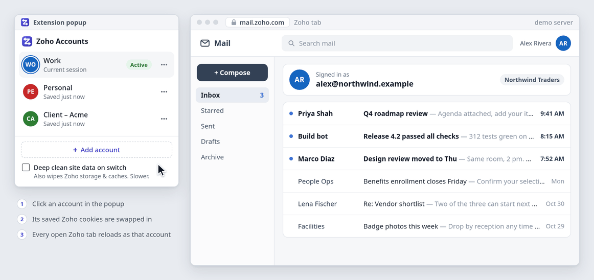
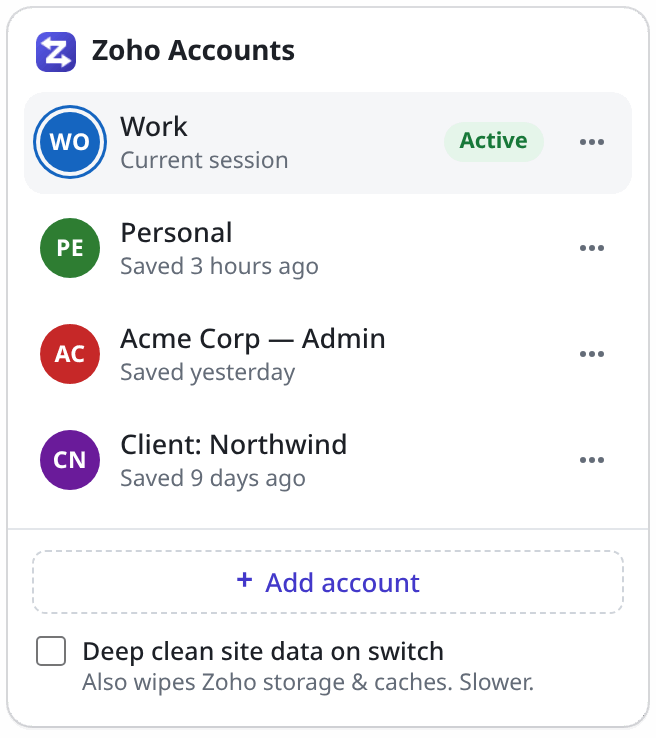
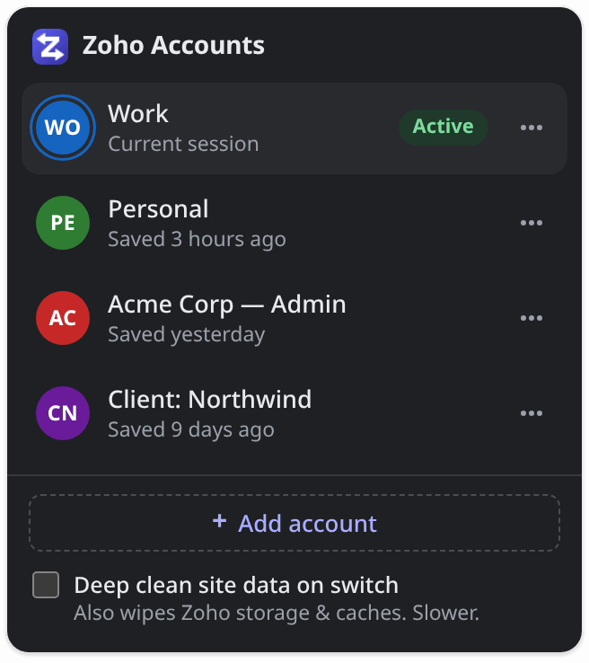
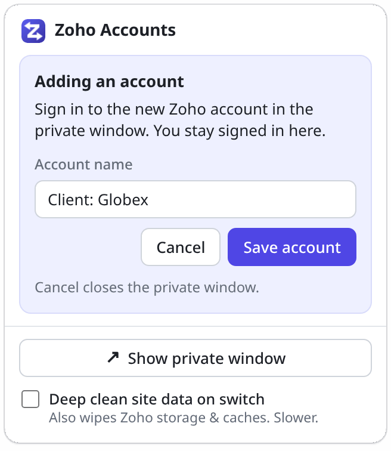
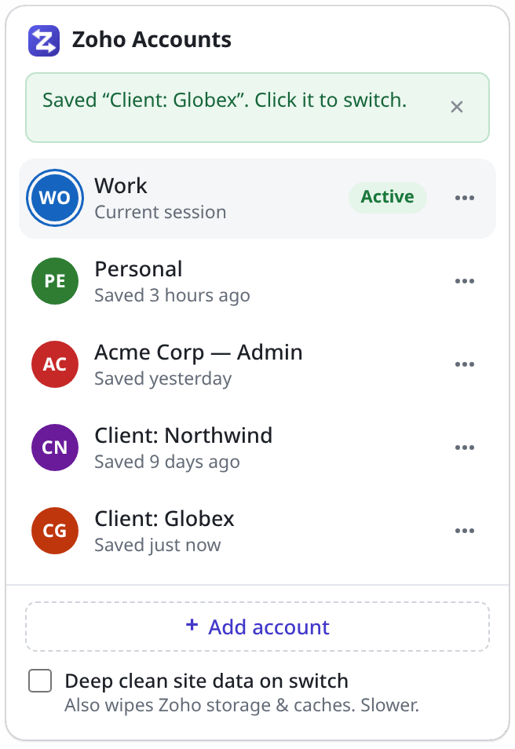
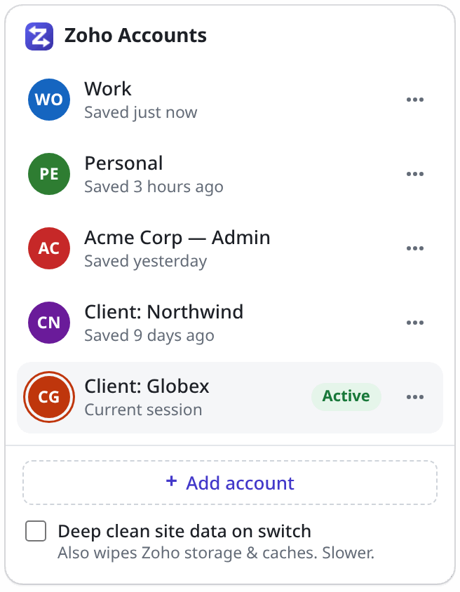
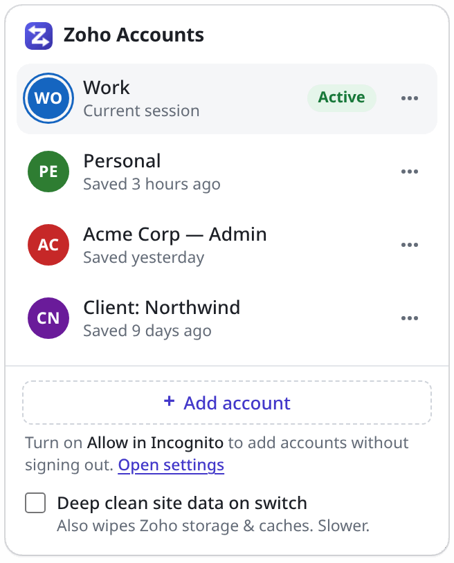
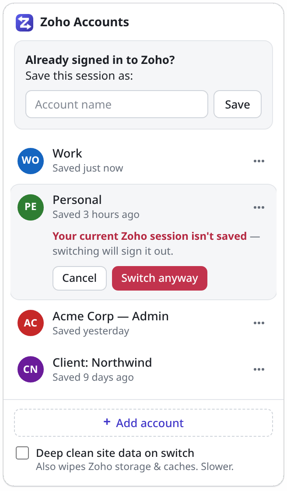
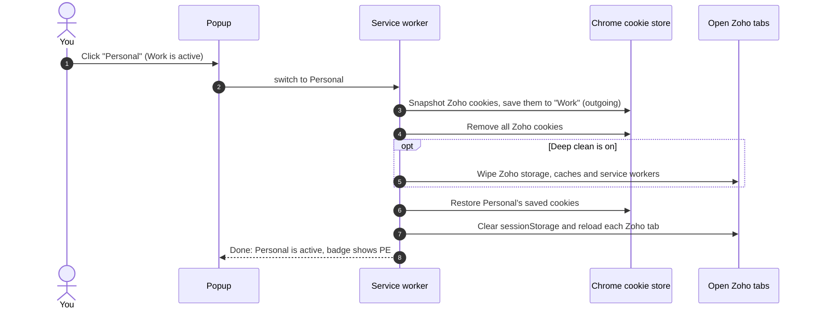

<div align="center">


# Zoho Account Switcher

Keep several Zoho accounts in one Chrome profile and switch between them in a click,<br>
without re-typing passwords or OTPs.

[](extension/manifest.json)
[](LICENSE)
[](#development)
[](#development)

</div>

<p align="center">
  
</p>

<p align="center">
  
  &nbsp;
  
</p>

## Why

If you work across several Zoho accounts (your company's org, a client's org, an admin login, a personal
account), Zoho gives you one signed-in account per browser profile. Changing account means signing out and
back in: password, OTP, and often a trip to Zoho Vault to look the credentials up first. Separate Chrome
profiles work, but they split your windows, bookmarks and extensions.

This extension has you sign in to each account **once**, keeps a copy of that session, and swaps sessions
on demand, in about a second, in the window you're already in.

## Features

- **One-click switching.** Every open Zoho tab reloads as the chosen account. The toolbar badge shows the
  active account's initials and colour.
- **Add accounts without signing out.** A new account signs in in a private (Incognito) window, so your
  current session, and Zoho Vault with the password and OTP you need, stays signed in.
- **Sessions stay fresh.** The active account is re-saved whenever Zoho rotates its cookies.
- **Hard to lose a session.** A signed-out or wiped cookie jar never overwrites a good saved copy, and a
  switch that gets interrupted is finished or rolled back.
- **Every Zoho data center**, from `zoho.com` to `zohocloud.ca` ([list](#supported-data-centers)).
- **Light and dark** popup, and a keyboard shortcut (<kbd>Alt</kbd>+<kbd>Shift</kbd>+<kbd>Z</kbd>).
- **Local only.** No servers, no analytics, no runtime dependencies, no build step.

## Install

The extension isn't on the Chrome Web Store; load it unpacked:

1. Get the code: `git clone https://github.com/Guhan-SenSam/zoho-account-switcher.git`, or download and
   unzip it.
2. Open `chrome://extensions` and turn on **Developer mode** (top right).
3. Click **Load unpacked** and choose the **`extension/`** folder (not the repository root).
4. Click **Details** on the extension's card and turn on **Allow in Incognito**. That lets you add accounts
   in a private window without signing out of the one you're on. Without it, adding an account signs you
   out first.
5. Optional: pin it from the puzzle-piece menu.

> [!NOTE]
> The manifest has a fixed key, so the extension id is always `cdejiijaefadneogcpfoadhdenpfgano`. Your saved
> accounts survive moving or re-cloning the folder. After pulling changes, click the reload icon on the
> extension's card.

## Usage

Open the popup from the toolbar, or press <kbd>Alt</kbd>+<kbd>Shift</kbd>+<kbd>Z</kbd> (change the shortcut at
`chrome://extensions/shortcuts`).

### Save your first account

Already signed in to Zoho? The popup offers **Save this session as…**. Type a name, click **Save**, and that
session is your first account. Not signed in yet? Sign in to Zoho as usual first, or use **+ Add account**.

### Add an account in a private window

With **Allow in Incognito** turned on:

<table>
<tr>
<td width="33%" valign="top">

<picture>
  <source media="(prefers-color-scheme: dark)" srcset="docs/images/private-pending-dark.png">
  
</picture>

**1. Sign in privately.** **+ Add account** opens Zoho's sign-in page in a private window. Sign in there
(Vault stays open in your normal window), then name the account and click **Save account**.

</td>
<td width="33%" valign="top">

<picture>
  <source media="(prefers-color-scheme: dark)" srcset="docs/images/private-saved-dark.png">
  
</picture>

**2. Saved.** The private window closes. Your current account stays active and the new one joins the
list.

</td>
<td width="33%" valign="top">

<picture>
  <source media="(prefers-color-scheme: dark)" srcset="docs/images/switched-dark.png">
  
</picture>

**3. Switch.** Click the new account. Every open Zoho tab reloads signed in as it.

</td>
</tr>
</table>

- You can open the popup from either window to save.
- Closed the private window before saving? If you had already signed in, **Save** still works. Otherwise
  click **Reopen private window**.
- **Cancel** closes the private window and changes nothing else.
- All Incognito windows share one cookie store, so any other Incognito windows get signed out of Zoho when
  an add starts or ends.

<table>
<tr>
<td valign="top">

**Without Allow in Incognito**

- The popup shows a hint. **Open settings** opens the extension's details page, where the toggle is.
- Until you turn it on, **+ Add account** signs the browser out of Zoho and opens the sign-in page in a
  normal tab. Sign in, name the account and **Save**.
- **Cancel** signs you back in to the previous account.

</td>
<td width="260" valign="top">

<picture>
  <source media="(prefers-color-scheme: dark)" srcset="docs/images/incognito-hint-dark.png">
  
</picture>

</td>
</tr>
</table>

### Switch accounts

<table>
<tr>
<td valign="top">

Click an account. Its saved session is swapped in and every open Zoho tab reloads as that account. All Zoho
tabs follow the active account. The toolbar badge shows its initials and colour.

**Unsaved session?** If the browser is signed in to a session you haven't saved (no account is marked
**Active**), switching away would sign it out, so the popup asks first. Save it with **Save this session
as…**, or click **Switch anyway**.

</td>
<td width="260" valign="top">

<picture>
  <source media="(prefers-color-scheme: dark)" srcset="docs/images/confirm-switch-dark.png">
  
</picture>

</td>
</tr>
</table>

### Rename, remove, deep clean

- **⋯** next to an account opens **Rename** and **Remove**. Removing only deletes the saved copy; it doesn't
  sign anything out.
- **Deep clean site data on switch** also wipes Zoho's local storage, IndexedDB, caches and service workers
  on every switch. It's slower; leave it off unless an app shows the previous account's data after a switch.

## How it works

Each saved account is a snapshot of every cookie on every Zoho domain. Switching swaps the whole Zoho cookie
jar:



- **Background sync.** While an account is active, every Zoho cookie change re-saves it (debounced 1.5 s,
  at most 10 s apart), so a rotated token never leaves a stale saved copy.
- **Safety guards.** A snapshot never replaces a saved session when the live cookies look signed out (empty,
  or missing the session's key cookies, e.g. after *Clear browsing data*). Operations run one at a time. A
  switch in progress is recorded, so if Chrome stops the service worker halfway, the next start finishes or
  undoes it. After a browser restart, session cookies Chrome dropped are filled back in from the saved copy.
- **Private-window adds** read and clear only the Incognito cookie store; the active account and your normal
  tabs are never touched.
- Accounts can't be separated per tab: Zoho apps use service workers, websockets and background polling
  that defeat per-tab cookie tricks.

The module contracts and message protocol are in the
[design doc](docs/superpowers/specs/2026-11-02-zoho-account-switcher-design.md).

## Privacy & security

- **Saved sessions are stored unencrypted** in the extension's local storage (`chrome.storage.local`) in
  your Chrome profile. They are live sign-ins: anyone who can read your profile folder could use them.
- **Nothing leaves your browser.** The extension makes no network requests of its own: no servers, analytics
  or telemetry. It asks for `cookies`, `storage`, `scripting` (to clear `sessionStorage` in Zoho tabs before
  reloading them) and `browsingData` (deep clean), with host access to Zoho domains only.
- **Don't use Zoho's own "Sign out"** for an account you want to keep. It ends the session on Zoho's servers,
  and you'll have to sign in again. Just switch.
- **Expired sessions.** If Zoho expires a session (or your org enforces a timeout), switching to that account
  lands on the sign-in page. Sign in again; the extension picks up the new session automatically.
- **The Zoho Vault browser extension keeps its own login** and isn't affected. Only the Vault web app follows
  the switch.
- **Each account belongs to one data center.** An account in the India data center is signed in on
  `*.zoho.in`, not on `zoho.com` services, so open its apps on its own domain (for example `mail.zoho.in`).

## Supported data centers

| Region         | Domain         |
| -------------- | -------------- |
| United States  | `zoho.com`     |
| India          | `zoho.in`      |
| Europe         | `zoho.eu`      |
| Australia      | `zoho.com.au`  |
| Japan          | `zoho.jp`      |
| China          | `zoho.com.cn`  |
| Saudi Arabia   | `zoho.sa`      |
| United Kingdom | `zoho.uk`      |
| Canada         | `zohocloud.ca` |

**+ Add account** opens `accounts.zoho.com/signin`; Zoho redirects to your account's data center.

## Development

There is no build step: the extension is plain ES modules. Edit, then click reload on the extension's card.
You need Node.js 22 or newer.

```sh
npm test                          # 447 unit tests (node:test); nothing to install
npm install                       # once: Playwright, for the E2E suite and README images
npx playwright install chromium
npm run test:e2e                  # 29 end-to-end tests against a fake Zoho server
```

- **Unit tests** run every module against fakes of the `chrome.*` APIs (`test/helpers/`).
- **E2E tests** load the real extension in Playwright's headless Chromium with a fresh, throwaway profile, and
  point `*.zoho.com` and `*.zoho.in` at a local HTTPS fake of Zoho (`test/e2e/fake-zoho/`). It issues
  realistic cookies: host-only and domain, `__Host-`, session and persistent, path-scoped, and an auth token
  that rotates. The suite covers adding accounts in both modes, switching with tabs reloading as the right
  user, token rotation, cancel, remove, deep clean, browser restarts and the popup.

The **popup harness** serves the real popup against canned states with a stubbed background. The self-test
and screenshot scripts run your installed Chrome headless (`google-chrome-stable`; set `CHROME_BIN` to
override), the README script uses Playwright's Chromium, and every browser they start gets a throwaway
profile.

```sh
node test/popup-harness/serve.mjs        # interactive gallery at http://127.0.0.1:8765
node test/popup-harness/selftest.mjs     # 40 UI checks, headless
node test/popup-harness/screenshot.mjs   # every state, light + dark → test/popup-harness/screenshots/
node scripts/readme-images.mjs           # the README screenshots → docs/images/
```

### Project layout

```text
extension/                 the extension: load this folder unpacked
├── manifest.json
├── background.js          service worker entry point
├── popup/                 popup UI (HTML, CSS, JS; no framework)
├── icons/
└── lib/
    ├── service-worker.js  wires chrome.* events to the modules below
    ├── router.js          popup messages, debounced cookie sync
    ├── switcher.js        switch, add, cancel, sync; one operation at a time
    ├── cookie-jar.js      snapshot, clear and restore Zoho cookies
    ├── session-guard.js   never save a signed-out jar over a good session
    ├── accounts.js        saved accounts in chrome.storage.local
    ├── private-window.js  the Incognito window used to add accounts
    ├── site-data.js       reload Zoho tabs, deep clean
    ├── badge.js           toolbar badge
    └── zoho-domains.js    Zoho data centers and host checks
test/
├── unit/                  node:test
├── e2e/                   Playwright + fake Zoho server
├── helpers/               fake chrome.* APIs
└── popup-harness/         the popup against canned states
scripts/                   dev scripts (README screenshots, demo)
docs/                      design doc, README images
```

## License

[MIT](LICENSE) © 2026 Guhan Sensam
